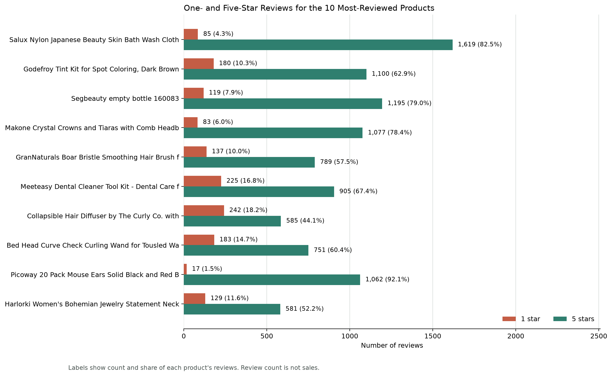
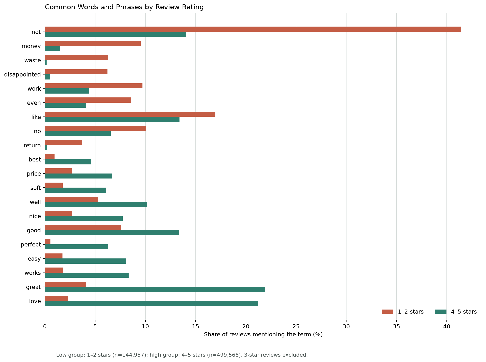
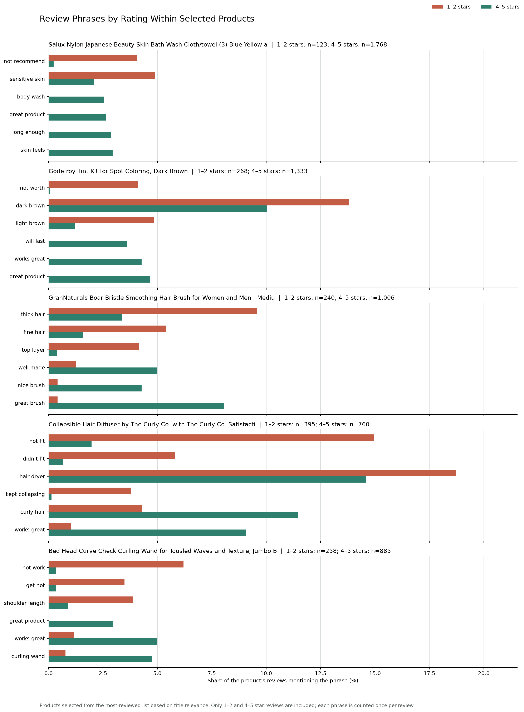

# Amazon Beauty Review Analysis

This analysis explores product ratings and customer review language in Amazon Reviews 2023's `All_Beauty` category. It compares low- and high-rated reviews across the category and within five selected high-review beauty and personal-care products.

## Research Questions

1. How do one- and five-star review counts differ among the most-reviewed products?
2. Which words and short phrases appear more often in low-rated reviews (1-2 stars) versus high-rated reviews (4-5 stars)?
3. Do those phrase patterns vary across selected high-review products?

These are exploratory comparisons. Phrase frequency indicates association with a rating group; it does not establish what caused a rating or measure objective product quality.

## Findings

### Product Rating Counts

Among the ten most-reviewed products, the Salux wash cloth has an 82.52% five-star share and a 4.33% one-star share. The Curly Co. diffuser has a 44.05% five-star share and an 18.22% one-star share.



[Product rating table](01_product_star_counts.csv)

### Review Language Across the Category

The pooled comparison includes 144,957 non-empty 1-2-star reviews and 499,568 non-empty 4-5-star reviews. Three-star reviews are excluded. Words such as `waste` and `disappointed` appear more often in the low-rating group, while `great` and `love` appear more often in the high-rating group. Single words can lose meaning without their sentence context.



[Pooled review-term table](02_review_terms_by_rating.csv)

### Phrase Patterns Within Selected Products

Five products were selected from the most-reviewed list based on title relevance: a wash cloth, hair-color tint kit, boar-bristle brush, hair diffuser, and curling wand. For the Curly Co. diffuser, `not fit` appears in 14.94% of low-rated reviews versus 1.97% of high-rated reviews; `kept collapsing` appears in 3.80% versus 0.13%. For the hair brush, `great brush` appears in 8.05% of high-rated reviews versus 0.42% of low-rated reviews.



[Product phrase comparison table](03_selected_product_phrase_comparison.csv)

## Data and Quality Checks

The source files contain 701,528 reviews and 112,590 product records. A quality check found valid integer ratings from 1 to 5, no missing review product IDs, and a 100% match between the 112,565 distinct review product IDs and metadata IDs. There are 720 blank review bodies; they are retained for rating counts but excluded from text analysis. Another 7,276 rows share a core review-field combination and are possible duplicates; they were not automatically removed. Price is missing for 84.28% of product records, so price analysis is out of scope.

[Data quality report](00_data_quality.csv)

## Data Source

The dataset is the Amazon Reviews 2023 `All_Beauty` category, published by the McAuley Lab at UC San Diego. Reviews span May 1996 through September 2023.

- [Amazon Reviews 2023 project](https://amazon-reviews-2023.github.io/)
- [McAuley Lab dataset page](https://mcauleylab.ucsd.edu/public_datasets/data/amazon_2023/)
- [All_Beauty reviews](https://mcauleylab.ucsd.edu/public_datasets/data/amazon_2023/raw/review_categories/All_Beauty.jsonl.gz)
- [All_Beauty product metadata](https://mcauleylab.ucsd.edu/public_datasets/data/amazon_2023/raw/meta_categories/meta_All_Beauty.jsonl.gz)

Raw files are excluded from Git. From the project root, download them with:

```bash
mkdir -p data/raw
curl -L "https://mcauleylab.ucsd.edu/public_datasets/data/amazon_2023/raw/review_categories/All_Beauty.jsonl.gz" -o data/raw/All_Beauty.jsonl.gz
curl -L "https://mcauleylab.ucsd.edu/public_datasets/data/amazon_2023/raw/meta_categories/meta_All_Beauty.jsonl.gz" -o data/raw/meta_All_Beauty.jsonl.gz
```

## Reproduce

Python 3.13 was used. Run the following from the project root; DuckDB reads the compressed JSON Lines locally, so no database server is needed.

```bash
python3 -m venv .venv
source .venv/bin/activate
python -m pip install -r requirements.txt
./.venv/bin/python scripts/01_inspect_data.py
./.venv/bin/python scripts/02_check_data_quality.py
./.venv/bin/python scripts/02_product_star_counts.py
./.venv/bin/python scripts/03_review_text_comparison.py
./.venv/bin/python scripts/04_product_review_comparison.py
```

## Limitations

- Review volume is not sales, orders, revenue, or inventory. Reviews reflect people who chose to leave feedback.
- The `All_Beauty` label includes some listings outside typical beauty and personal care. The five product-level examples were selected by title relevance and are illustrative, not representative of the whole category.
- Text analysis uses simple English tokenization, stop-word removal, and review-level word or adjacent-phrase frequencies. It is not a topic model, sentiment model, or causal analysis.
- Three-star reviews are omitted from low/high text comparisons. Possible duplicate rows were not removed, and rating-group sizes differ.
- This is historical marketplace feedback, not a live view of current Amazon rankings, reviews, or prices.